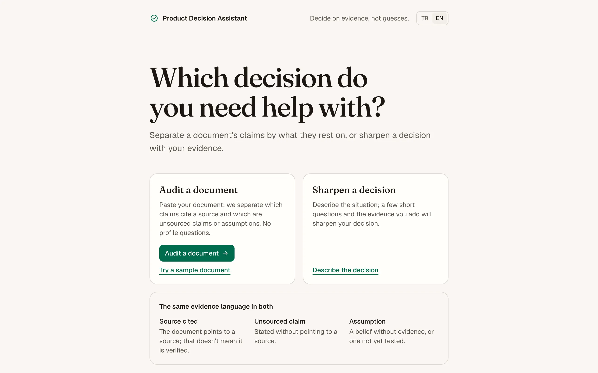
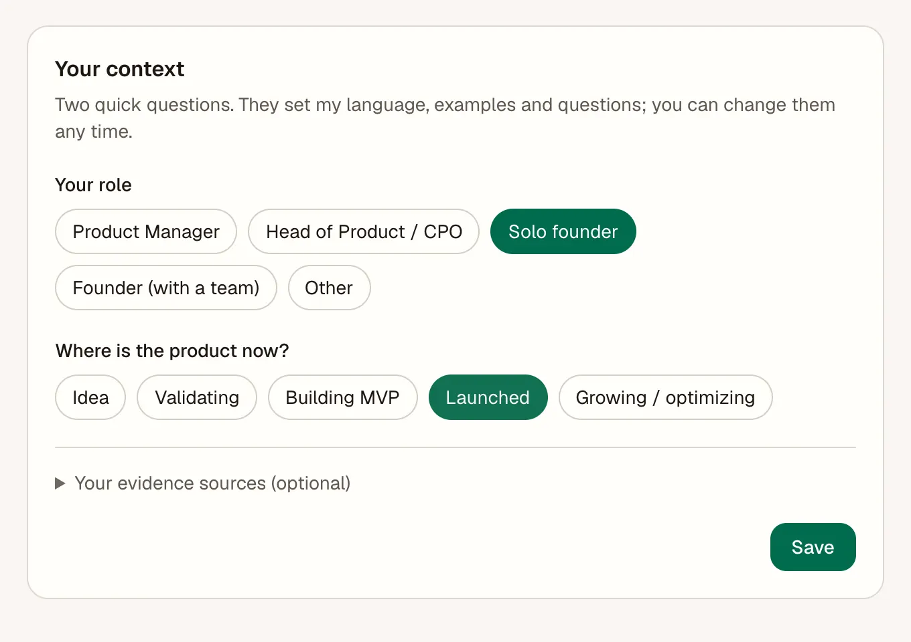
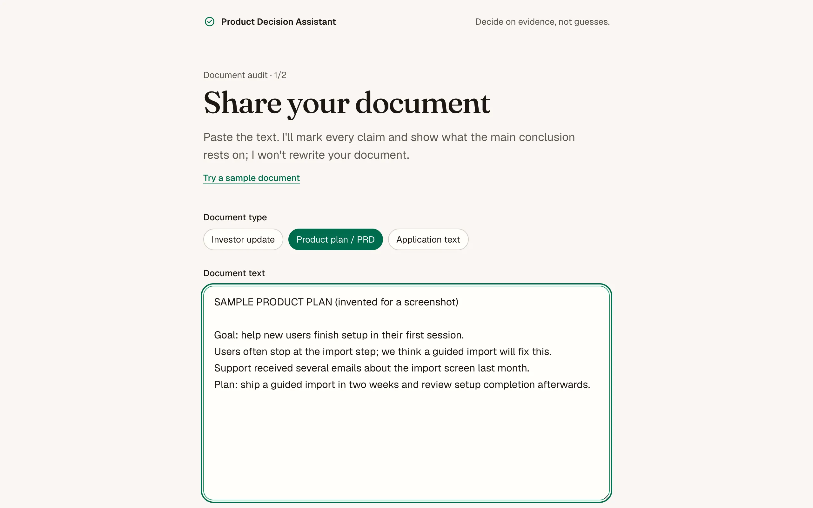
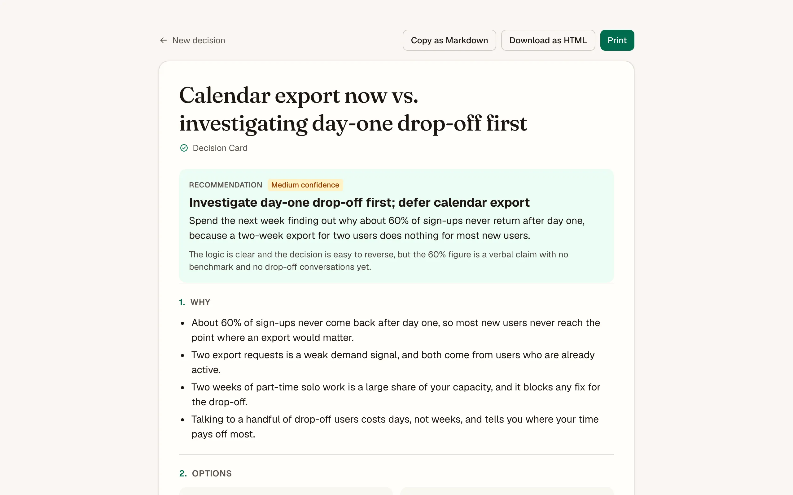
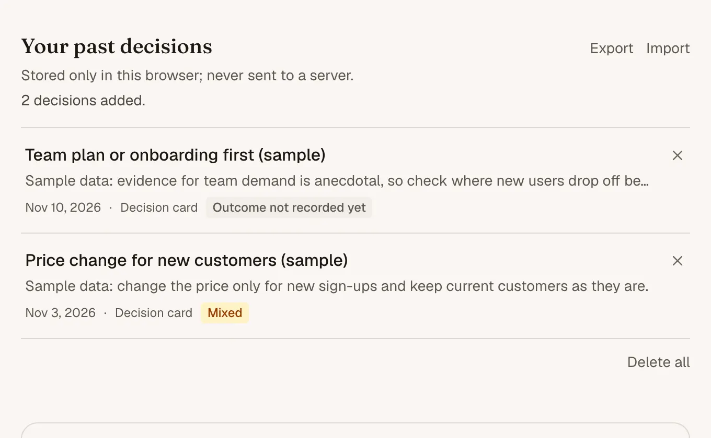

# AI Product Decision Intelligence

An evidence-aware decision companion for product decisions. It helps a product person see which evidence supports a decision: what was **observed**, what users **reported**, what is only a **hypothesis**, and what is still **missing**. It is not a generic AI idea validator or a project-management tool.

> **Status: in development and experimental.** It runs locally and is not deployed. There is no real-user validation yet, and no users, revenue or adoption are claimed. The source code is private; this repository documents the product thinking.
>
> Part of [Ahsen Varlı İçgüdel's portfolio](https://ahsenvarlicgudel.vercel.app) · [LinkedIn](https://www.linkedin.com/in/ahsen-varl%C4%B1-i%C3%A7g%C3%BCdel-2b785018)

## Problem and target user

Small products often get decisions made on little data and intuition. The main risk is less bad advice than trusting something that looks like evidence but is not, for example "users want this" resting on a small part of a research sample.

**Target segment (an assumption, not yet validated):** a solo founder with a launched product, little analytics, low traffic and no PM experience. Whether this segment looks for such a tool, rather than using a general chat assistant, is untested.

## Key capabilities

- **Decision conversation and decision card.** Clarifying questions, then a structured result with a recommendation, confidence and rationale.
- **Evidence labelling.** Each piece of evidence is labelled by source (chat, verbal statement, file, screenshot, store data, connected tool) and by level (none, anecdotal, partial measurement, measured). Information status is shown as known, partly known, not yet shared or conflicting.
- **Document audit.** Checks documents such as a product plan or PRD. It separates each claim's type and its basis in the document. It does not judge whether a claim is true.
- **Read-only tool connections.** Jira and Linear through OAuth, plus a Mixpanel connection. Jira and Linear are requested with read scopes only. Text returned by a connected tool is treated as data, not instructions.
- **Lifecycle guidance.** Up to three potentially overlooked steps, for solo founders with a launched product only. This limit is deliberate.
- **Decision history in the browser.** No account and no server-side storage of history.
- **Bilingual** (Turkish and English).

| | |
|---|---|
|  |  |
| Role and stage adapt language and assumptions. | Document audit input. |
|  |  |
| A decision result (real model output on an invented decision). | History stored only in the browser. |

All screenshots use invented sample data.

## Selected product decisions and trade-offs

- **Evidence honesty over "better advice".** Measured differences were in separating measured, claimed and unknown information and in matching confidence to evidence. They were not in overall advice quality, so the product doesn't claim better advice.
- **Extend, don't rewrite.** The decision engine grows incrementally. No agent framework, MCP server or new integration is added without explicit approval.
- **Context shapes the questions, not the answer.** Role and stage adapt language and checkpoints but must not predetermine the recommendation.
- **No invented numbers.** The product never invents metrics, provenance, user research or confidence percentages, and "not shared" is never shown as "does not exist".
- **Privacy by architecture.** History and profile stay in the browser. The product also states that "your data goes nowhere" can't be claimed, because chat and cards go to a hosted model API.
- **Read-only integrations** with fixed query shapes. Users never send raw queries.
- **Optional lifecycle output** that can't break the main result. A bad lifecycle output is validated away.
- **Model choice by evidence.** Document audit runs on a larger model. In a 10-case evaluation, a smaller model was about one-thirtieth of the cost per case but missed the main conclusion twice and failed once.

## Architecture overview

Browser (bilingual UI, local storage) → server routes (chat, decision brief and card, evidence extraction, classification, document audit, store reviews, tool connections) → hosted model API → schema validation → result in the browser with evidence labelled by source and level.

A CSV file is read in the browser and only a summary sentence is sent. Connection tokens live only in the user's browser as encrypted httpOnly cookies, so a server breach exposes none.

## Technology (verified from source)

Next.js 16 and React 19, TypeScript, Zod schema validation, Anthropic SDK, TypeSafe SDK for evaluation and classification calls, Tailwind CSS. Tests, type check, lint and build run in GitHub Actions on every pull request.

## Evaluation, with limits

Small, scripted evaluations were run, and negative findings are recorded. They are not claims of accuracy.

- **Live scenarios (9):** 8 passed and 1 partly passed. In that case the recommendation type changed between runs. This is recorded as an open issue.
- **Comparison against general chat assistants:** clearly ahead on separating measured, claimed and unknown information, and on matching confidence to evidence. No difference on overall decision quality, and behind on "fewer invented figures" on a metric I judged unreliable.
- **Document audit (10 cases):** the larger model completed 10 of 10. No invented figures were found, and neither model obeyed instructions injected into the document.
- **Limits:** 5 to 10 cases, a model acting as judge with a measurable order effect, a single human scorer, no real users.

Learning: a model judge is a weak instrument, so borderline results were checked by hand and some metrics were declared unreliable instead of reported as findings.

## Current status and next steps

In development and experimental. Planned next steps are about learning (interviews with solo founders, a wider comparison with human raters), not growth. Legal drafts await a lawyer's review, and nothing is published for end users.

See also: [how this product is built with agents](docs/agent-based-development.md).
