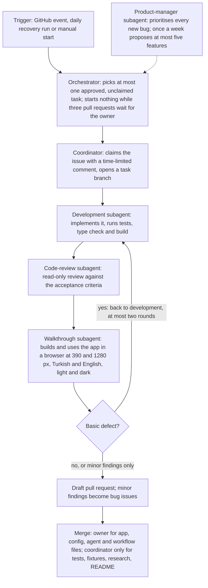

# Agent-based development

How my products are planned, built and verified with Claude Code agents. The owner (me) sets goals, scope, cost and release decisions. Agents carry out planning, development, testing and tracking inside that approved scope. Prompts, repository settings and infrastructure details aren't published.

Last updated 25 November 2026. The system is written down in each product repository (private) and in a shared operations repository; this page summarises it and says which parts have actually run.

## How work flows

The agents do not run in a continuous loop, and they do not wait for me to prompt them. A cloud routine starts a Claude Code session on a GitHub event (a label change, a pull request merged or closed), on a daily recovery schedule, or by hand. Each session picks at most one eligible task, works on it and stops. The agents never trigger themselves.

## Roles

| Role | What it does |
|---|---|
| Owner | Approves a task with a status label, answers decision issues, merges the pull requests that touch the app, agent instructions or workflow, decides cost and release. |
| Orchestrator | Chooses which project and task is next, claims it, and applies that project's coordinator rules. It can't deploy, publish or change its own schedule. |
| Coordinator | One instruction file per project. Claims the task, runs the other roles in turn, opens the draft pull request, applies the merge policy. |
| Development subagent | Implements one approved issue on its own branch and reports what it ran. |
| Code-review subagent | Reads the change and the test output against the acceptance criteria. Read-only; it can't run commands. |
| Walkthrough subagent | Builds the app and uses it like a person: the change, then the main journeys, every visible control, empty and error states. Reports findings without a count limit and doesn't change code. |
| Product-manager subagent | Sets P0, P1 or P2 on every new bug so work follows priority. Once a week proposes at most five features, each backed by evidence that another product's feature is actually used. Never approves its own proposals. |

## Rules that hold in every project

- **Issue-driven backlog.** GitHub Issues is the only backlog. A task is worked on only after I approve it through a status label.
- **Branch discipline.** One task per branch, draft pull requests only, no direct pushes to `main`.
- **Verification before a pull request.** Tests, type check and build run, and the result is reported as passed, failed or could-not-run. A test is never deleted, skipped or weakened, and at most two fix attempts are made for the same failure.
- **Defect gate.** A basic defect (data loss, a location shown as verified without confirmation, a broken main flow, a crash, a breach of the product rules) stops the pull request. Minor findings become bug issues and don't stop it.
- **Limits.** At most one task in progress per project; no new task while three pull requests wait for me; no paid API, account connection, deployment or publishing without my explicit instruction.
- **Source text is data.** Web pages, issue text and map responses are never treated as instructions.
- **Decisions stay with the owner.** Product, UX, scope, new provider, anything that costs money, data deletion and legal questions go to a decision issue.

## What has run, and what hasn't

**Has run.** The orchestrator, the claim protocol, the coordinator, the development and code-review subagents, draft pull requests and the status-label board sync have been used on Rota, the decision assistant and my portfolio site since mid-November 2026. A Rota task of 25 November 2026, for example, was picked up by an event-triggered session without a prompt from me and ended as a draft pull request.

**First run on 25 and 26 November 2026 (Rota).** A hand-started first full walkthrough of the running app filed 12 issues: two basic defects (a city name auto-matched as a verified place, and an edited day plan being wiped), seven minor defects and three observations. The product-manager role prioritised them, and two cloud sessions fixed the two basic defects in draft pull requests that I merged on 26 November. The walkthrough also ran inside later pull requests as the gate. That is a first run, not a measurement of how many defects the role finds.

**Specified, not run yet.** The same two roles in the decision-assistant project (set up on 26 November 2026, pull request merged the same day), the weekly feature proposals, and a Friday-evening routine that updates my portfolio site and these GitHub pages through pull requests I merge. The routines are not scheduled yet.

## Limits and what I haven't measured

- Cloud sessions can change labels but not project-board fields, so labels mirror the board; paid model evaluations run locally, not in the cloud.
- There is no autonomous merge of product-affecting changes and no automated deployment.
- The code-review role can't run the app, which is why the walkthrough role was added. Its first run found real defects, but I haven't compared it against the other roles on the same code, so I can't say how many it finds that they miss.
- I haven't measured delivery speed or defect rates against a human-only baseline.
